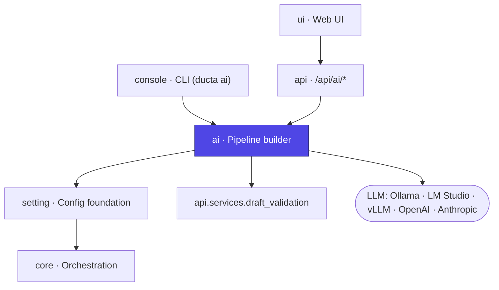

# Ducta AI

> **The AI pipeline builder of Ducta.** A model of your choice — **local** (Ollama, LM Studio, vLLM, llama.cpp) or **remote** behind an API key (Anthropic, OpenAI, any OpenAI-compatible endpoint) — drafts a new format-2 pipeline from a description in plain language, or a fix for an existing one. Every draft is checked by the same validation the UI runs on unsaved edits; its problems go back to the model until it passes. **Nothing is written until a person accepts the draft, and nothing is ever run or committed.**

## At a glance

| | |
|---|---|
| **Purpose** | Draft new pipelines, and fixes for broken ones, with an LLM — validated, reviewable, opt-in |
| **Layer** | Authoring assistance (sits beside `setting`; never on the execution path) |
| **Depends on** | `setting` (project loader), `api` (`validate_draft`, `code_index`), `core` (`DuctaError`) |
| **Used by** | `console` (`ducta ai …`), `api` (`/api/ai/*`, `/api/projects/{id}/ai/*`) |
| **Key entry points** | `load_config`, `make_provider`, `generate`, `fix`, `apply_draft`, `build_context` |
| **Install** | `pip install "ducta[api,ai]"` — `ai` brings `httpx`, `anthropic`, `keyring`; `api` brings the validator |

## Where it fits



`ai` produces **files**, never runs. In the UI it is *Build with AI* (project pipelines; *Several pipelines — design first* is Ducta Architect, `components/AI/Architect.tsx`), *Fix with AI* (a pipeline's problems, a failed run), *Runs → Reliability* (Sentinel, `pages/SentinelPage/`) and *Settings → AI* (`src/ducta/ui/src/components/AI/`, `pages/ProjectSettingsPage/AISettings.tsx`). Its output reaches the engine only after a person applies a draft and runs the pipeline like any other.

---

## 1. Overview

### For Non-Technical Users
Writing a pipeline means knowing Ducta's YAML, the project's catalog, and how node functions are wired. Ducta AI is an **assistant that writes the first draft for you**:
*   **Describe what you want** — "a gold pipeline that averages grades per school" — and get the pipeline file, the Python code and the new dataset entries.
*   **Or point at a broken pipeline** — with its validation errors, the error a run failed with, or a note in your own words — and get a proposed fix.
*   **The draft is checked before you see it.** If Ducta's validator finds problems, the assistant is told and tries again.
*   **You decide.** You see exactly what would change (a diff) and nothing touches your project until you click *Apply* (or run `ducta ai apply`).
*   **You choose where the AI runs.** A local model keeps everything on your machine; a cloud model needs an API key and receives your project's configuration (never your data).

### For Technical Users
Ducta AI is a small generate → validate → repair loop:
*   **Two wire protocols, five presets** (`providers.py`): `OpenAICompatibleProvider` (`/chat/completions` over `httpx` — LM Studio, vLLM, llama.cpp, OpenAI, gateways), `OllamaProvider` (native `/api/chat`, so it can set `num_ctx`), and `AnthropicProvider` (official `anthropic` SDK, server-side refusal fallbacks on current models).
*   **Per-machine configuration** (`config.py`): `~/.ducta/ai.toml` + `DUCTA_AI_*` overrides. Never in `ducta.yaml`, never a key.
*   **Key resolution** (`secrets.py`): the provider's environment variable first, then the OS keychain via `keyring`. No plain-text fallback.
*   **Project context** (`context.py`): catalog, pipelines, source names, function signatures and one example of house style — read from files and syntax trees, nothing imported, no data rows.
*   **The loop** (`builder.py`): parse fenced file blocks from the answer → constrain them to a `Scope` → `validate_draft` on a scratch copy → judge against the project's baseline errors → feed the blocking problems back → repeat up to `max_attempts`.
*   **Drafts** (`builder.py`): saved as JSON under `<project>/.ducta/ai/drafts/`, applied only if every touched file still has the hash it had when the draft was made.
*   **Proposals** (`proposals.py`): a node's checks (`propose_quality`) and missing descriptions (`propose_docs`). The model answers with the proposal only; an *assembler* passed to the loop applies it with `yaml_edit.edit_yaml` (comments and layout kept) and can add nothing else. Proposed checks run on the measured output (`run_on_sample`) and those that fail go back to the model.
*   **Explanations** (`explain.py`): a failed run's diagnosis (`api/services/diagnosis.py`), its error and the code around the line — or the failing node's function — turned into *what happened / why / what to do*. Changes nothing; kept in `.ducta/ai/explanations/<run>.json`.

---

## 2. Configuration & Schemas

### `~/.ducta/ai.toml`

Which model runs is a property of the machine (a laptop with Ollama, a CI runner with a key), not of the project, so the configuration lives in the user's home — `DUCTA_HOME` moves it. Only what differs from the provider's preset is written.

| Key | Default | Meaning |
|---|---|---|
| `provider` | — (required) | `ollama` · `lmstudio` · `openai_compatible` · `openai` · `anthropic` |
| `model` | preset's (`claude-opus-5-5` for Anthropic; none otherwise) | Model name as the provider knows it |
| `base_url` | preset's | Endpoint; required for `openai_compatible` |
| `api_key_env` | preset's (`OPENAI_API_KEY`, `ANTHROPIC_API_KEY`) | **Name** of the variable holding the key — never the key |
| `effort` | unset | Anthropic only: `low` · `medium` · `high` · `xhigh` · `max` |
| `timeout_seconds` | `300` | Per request; raise it for a slow local model |
| `max_attempts` | `3` | Generate → validate rounds |
| `context_tokens` | `16384` | Ollama only: the context window requested (`num_ctx`) |

Environment overrides for one shell: `DUCTA_AI_PROVIDER` (switching provider starts from that provider's preset), `DUCTA_AI_MODEL`, `DUCTA_AI_BASE_URL`.

### Presets

| Provider | Protocol | Default endpoint | Key | Local |
|---|---|---|---|---|
| `ollama` | Ollama native (`/api/chat`), models via `/v1/models` | `http://localhost:11434/v1` | none | ✓ |
| `lmstudio` | OpenAI-compatible | `http://localhost:1234/v1` | none | ✓ |
| `openai_compatible` | OpenAI-compatible | `--base-url` (required) | `api_key_env`, if set | if the host is local |
| `openai` | OpenAI-compatible | `https://api.openai.com/v1` | `OPENAI_API_KEY` | |
| `anthropic` | Anthropic SDK | `https://api.anthropic.com` | `ANTHROPIC_API_KEY` | |

"Local" means the host is `localhost`, `127.0.0.1`, `::1`, `0.0.0.0` or `host.docker.internal`; the CLI and the UI say so, and say where data goes otherwise.

### API keys

`secrets.resolve_key` looks in this order and reports the source (`env:NAME`, `keychain`, `none`) and a mask (`sk-…3f9a`), never the value:

1. The variable named by `api_key_env` — except a provider's own variable (`OPENAI_API_KEY`, `ANTHROPIC_API_KEY`) when `base_url` points elsewhere (`secrets.env_key_allowed`): another endpoint needs a variable of its own (`--api-key-env NAME`) or a keychain key.
2. The OS keychain — service `ducta-ai`, user = provider name for the provider's own endpoint, `provider@host` for any other (`secrets.keychain_user`) — written by `ducta ai login` or `PUT /api/ai/key`. A key is therefore only ever sent to the endpoint it was stored for.

A local provider needs no key. A remote one without a key fails before any request, naming both ways to provide one. On a host without a keychain backend (a Linux container), storing is refused: use the variable.

### What a draft may touch — `Scope`

| | `generate` (`kind="new"`) | `fix` (`kind="fix"`) |
|---|---|---|
| Pipeline file | exactly **one new** `pipelines/<name>.yaml` | rewrite **that** pipeline's file only |
| Python | **new** modules only | also rewrite the existing modules its nodes `run:` |
| Catalog | **new** entries, appended (`catalog.yaml`) or a new `catalog/<pipeline>.yaml` | same |
| Anything else (`ducta.yaml`, `sources.yaml`, data, `.env`…) | rejected | rejected |

Paths must stay inside the project (no `..`, no absolute path, no symlinked folder leading out); code never goes in `data/`, `lib/`, `venv/` or a hidden folder, and a draft never adds a file Python runs on its own (`conftest.py`, `sitecustomize.py`, `setup.py`…). Existing entries in the catalog are never redeclared; a file returned unchanged is dropped from the draft. A problem with a path goes back to the model like any validation error.

### When a draft is "ok"

The project is validated once before the loop (the **baseline**). An attempt's **blocking** problems are:
*   errors the draft **adds** (not in the baseline), and
*   for a fix, every error still on **the pipeline being fixed**,
*   plus anything the `Scope` rejected.

A draft is `ok` when it has files and nothing blocks. Problems the project already had elsewhere are kept in `problems` for information but do not block. A fix for a *runtime* error is checked statically only — run it in `dev` to confirm.

---

## 3. Configuration Examples

```toml
# ~/.ducta/ai.toml — a local code model through Ollama
provider = "ollama"
model = "qwen2.5-coder:14b"
context_tokens = 32768      # a large project: ask for a bigger window
timeout_seconds = 600       # a slow laptop
```

```toml
# ~/.ducta/ai.toml — Claude; the key comes from ANTHROPIC_API_KEY or the keychain
provider = "anthropic"
effort = "high"
```

```toml
# ~/.ducta/ai.toml — a team vLLM server behind a gateway that wants a token
provider = "openai_compatible"
base_url = "https://llm.internal.example.com/v1"
model = "Qwen/Qwen2.5-Coder-32B-Instruct"
api_key_env = "LLM_GATEWAY_TOKEN"
```

```bash
# The same from the CLI
ducta ai setup --provider ollama                   # picks the largest code model the server has
ducta ai setup --provider anthropic --effort high
ducta ai login                                     # key into the keychain (hidden prompt)
ducta ai doctor                                    # config, key source, connection, models

# Drafting
ducta ai new "silver pipeline that deduplicates orders and casts amounts to decimal"
ducta ai fix silver.clean                          # its validation problems
ducta ai fix silver.clean --error-file run.log     # a run's traceback
ducta ai fix silver.clean --note "Tuition comes in cents"
ducta ai revise 20261010-172522 --note "group by year too"   # ask for changes
ducta ai drafts
ducta ai apply 20261010-172522                     # review, confirm, write
```

### What the model answers

The system prompt asks for fenced blocks whose info string names the file — plain text survives small local models far better than JSON with escaped code:

````text
```yaml file=pipelines/gold.school_grades.yaml
description: Average grades per school
nodes:
  gold.school_grades:
    run: src.gold_school:school_grades
    inputs: {student_cleaned: silver.education.student_cleaned}
    outputs: [golden.education.school_grades]
```
```yaml catalog
golden.education.school_grades: {description: G1, G2 and G3 averages per school}
```
```python file=src/gold_school.py
def school_grades(student_cleaned, **kwargs): ...
```
````

New modules go in the project's code folder (`builder.code_folder`: the folder most `run:` references use — `pipelines/` in templates, else `src/`); the request names it under "Where code goes", and `_check_path` accepts a module in `pipelines/` when that folder is a package.

`parse_answer` also accepts a `# file: path` first line, and `assemble` places blocks with no name when their content says where: a mapping with `nodes:` is the pipeline, a mapping of dotted keys is catalog entries, a Python block is the one new module the pipeline's `run:` points to.

---

## 4. Python Quickstart

### Step 1: Choose and check a provider

```python
from ducta.ai.config import build_config, load_config, save_config
from ducta.ai.providers import make_provider

save_config(build_config("ollama", model="qwen2.5-coder:14b"))   # ~/.ducta/ai.toml
config = load_config()                     # file + DUCTA_AI_* overrides
provider = make_provider(config)           # resolves the key; raises AIConfigError if missing
print(config.label, config.is_local, provider.list_models())
```

### Step 2: See what the model will be told

```python
from ducta.ai.context import build_context

ctx = build_context("path/to/project")
print(ctx.render()[:2000])                 # catalog, pipelines, sources, signatures, examples
```

### Step 3: Draft a new pipeline

```python
from ducta.ai.builder import generate, save_draft

draft = generate(
    "path/to/project",
    "gold pipeline that averages G1, G2 and G3 per school",
    provider,
    on_attempt=lambda a: print(f"attempt {a.number}: {a.errors} blocking"),
)
print(draft.ok, list(draft.files))
print(draft.diff("path/to/project"))       # unified diff against the project as it is
save_draft("path/to/project", draft)       # .ducta/ai/drafts/<id>.json
```

### Step 4: Draft a fix

```python
from ducta.ai.builder import fix

draft = fix(
    "path/to/project",
    "silver.clean",
    provider,
    error=open("run.log").read(),          # optional: a run's traceback
    note="Tuition comes in cents",         # optional: what you know
)
for p in draft.blocking:
    print(p["message"])
```

### Step 5: Apply

```python
from ducta.ai.builder import apply_draft, list_drafts, load_draft

latest = list_drafts("path/to/project")[0]
written = apply_draft("path/to/project", load_draft("path/to/project", latest.id))
# Raises AIConflictError if a file changed since the draft was made, or if it
# was already applied. Nothing is committed: that stays the user's step.
```

### Step 6: Ask for changes

```python
from ducta.ai.builder import revise

better = revise("path/to/project", draft, "group by school and year", provider)
assert better.revision_of == draft.id      # same conversation, continued
```

A revision re-sends the first prompt as it was, so it raises `AIConflictError` if a file that prompt showed in full (a fix's editable files) changed since — the model would otherwise rewrite the old text over your edits. Draft the fix again instead.

### Step 7: Use another model in tests

Anything with `config`, `complete(system, messages)` and `list_models()` is a provider:

```python
from ducta.ai.config import AIConfig
from ducta.ai.providers import Completion

class Canned:
    config = AIConfig(provider="ollama", model="canned", base_url="http://localhost:1/v1")
    def __init__(self, *answers): self.answers = list(answers)
    def complete(self, system, messages): return Completion(self.answers.pop(0), "canned")
    def list_models(self): return ["canned"]
```

---

## 5. Over HTTP

The server exposes the same builder (`ducta/api/routes/ai.py`). Generation can take minutes on a local model, so it runs as a **job** the client polls.

| Route | Permission | Does |
|---|---|---|
| `GET /api/ai/settings` | `ai.use` | Provider, model, endpoint, local or not, key source + mask, the presets |
| `PUT /api/ai/settings` | `ai.configure` | Choose the server's provider and model. Partial: fields left out are kept, `null` resets one (`config.update_config`). `api_key_env` must be the provider's own variable or `DUCTA_AI_*`; another endpoint for `openai`/`anthropic` needs its own key |
| `PUT` / `DELETE /api/ai/key` | `ai.configure` | Keep / remove a key in the server's keychain; never returned |
| `GET /api/projects/{id}/ai/explanations/{run}` | `ai.use` + `execution.read` | The kept explanation of a failed run |
| `GET /api/ai/models` | `ai.use` | The provider's models (also a connection test) |
| `POST /api/ai/models/test` | `ai.configure` | The same for settings not saved yet (body of `PUT /api/ai/settings`); saves nothing |
| `POST /api/projects/{id}/ai/jobs` | `ai.use` + `project.read` | Start `{"request": …}`, `{"kind": "fix", "pipeline": …, "note"?, "error"?, "execution_id"?}` or `{"kind": "revise", "draft_id": …, "note": …}` → `202` |
| `GET /api/projects/{id}/ai/jobs/{job}` | `ai.use` | Attempts so far; `draft_id` and `ok` when done; `error` if it failed. Only its owner (or `ai.configure`) sees it |
| `DELETE /api/projects/{id}/ai/jobs/{job}` | `ai.use` | Stop it: `cancelled` at once, no further model request, no draft |
| `GET /api/projects/{id}/ai/drafts[/{draft}]` | `ai.use` | Summaries; one draft with files (`added`/`modified`), diff, problems, attempts, `stale_files` |
| `POST /api/projects/{id}/ai/drafts/{draft}/apply` | `ai.use` + `pipeline.write` | Write it; `400` if invalid — as made, or validated again now — without `force`, `409` if stale or already applied |
| `DELETE /api/projects/{id}/ai/drafts/{draft}` | `ai.use` | Discard it |

`ai.use` is a developer permission; `ai.configure` is admin-only, because a remote provider receives project configuration. At most two jobs run at once per server process (`429` otherwise), on their own thread pool. Jobs are written to `.ducta/ai/jobs/` as they progress (any worker answers a poll or a stop, through `<id>.cancel`); drafts to `.ducta/ai/drafts/`.

---

## 6. Privacy & Safety

*   **What is sent**: dataset names, formats, descriptions and declared schemas; pipelines and nodes; source *names* and types; the `format` of each catalog default (not its paths or options); public function signatures; one example pipeline file and one node function, with credentials written in them masked (`context.redact_code`). A fix also sends the files it may change, whole, and, when given, the run's error and your note. A file it may change that holds a credential (`context.find_secrets`, which in YAML also sees unquoted values such as `password: …`) is never sent to a remote provider: the fix is refused, since the model would write `***` back over the value. A revision re-checks those files against the provider it is sent to.
*   **Credentials written in settings are masked wherever a setting is sent** (`context.redact_config`): an ingest node's inline `options`, a node's spec and effective settings in a review, `spark_config` (a storage key), the diagnosis of a failed run. A value is masked when its name is a credential's (`password`, `token`, `fs.s3a.secret.key`, `…account.key…`, `sasToken`; not `token_url` or `api_key_env` — `context.is_secret_name`) and is not a `${VAR}` placeholder; other text goes through `context.redact`.
*   **What is never sent**: data rows, `sources.yaml` connection settings, catalog paths and options, `.env`, anything under `data/`, `logs/`, `models/`, `lib/`, `venv/` or a hidden folder.
*   **A run's error is masked, not filtered.** Before a failed run's error (and the diagnosis that quotes it) goes to the model, a URL's password, `password=` / `token=` / `api_key=`-style values and bearer tokens become `***` (`context.redact`). Other text in the error goes as it is; with a remote provider, read it first if your errors might contain data values.
*   **The context has a size limit** (`MAX_CHARS`, ~10k tokens), smaller for Ollama: a request is sized to `context_tokens`, leaving room for the answer and one retry (`builder.message_budget`), and refused before any call when it cannot fit. The function list shrinks first ("… and N more not listed"), so a large project keeps its catalog and its examples. A retry sends the request, the last answer and Ducta's feedback on it — not every earlier attempt.
*   **Nothing is imported or executed** to build the context or to validate a draft: code is read through its syntax tree, and validation runs the format-2 loader on a scratch copy.
*   **Nothing is written** before `apply_draft`, and `apply_draft` refuses if any file changed since it was read to make the draft — including a file edited while the model was answering. Unless forced, it validates the draft again against the project as it is now. It holds the draft's paths to the rules of its kind again (a draft is a JSON file anyone could edit): a `new` or `fix` draft to the table above, a `quality` draft to its pipeline's file, a `docs` draft to the project's catalog and pipeline YAML files; every file must say what it was made from (`base`), even `force` does not skip this. It writes every file to a temporary copy before replacing any, so a failure leaves the project as it was.
*   **What a draft adds is bounded.** A new catalog entry cannot point (`path`, `table`) at data an existing dataset names, and one its pipeline writes keeps its path inside the project. A new module cannot shadow the standard library, nor a new top-level one an installed package.
*   **Nothing is committed or run.** Committing and running stay the user's steps.
*   **Statically valid is not correct.** A model can produce a draft that validates and still does the wrong thing (edit the wrong node, compute the wrong column). The diff review is the safeguard; keep it.

---

## 7. Errors

All errors derive from `AIError` (a `DuctaError`, so the API maps them to a status) and carry a message that names what to run or set. None contains a key.

| Class | HTTP | Raised for |
|---|---|---|
| `AIError` | 502 | The provider: unreachable, timed out, rejected the key, refused, answered something unexpected |
| `AIConfigError` | 400 | No provider / model / key, unknown provider, empty request, project does not validate, nothing to fix |
| `AINotFoundError` | 404 | Unknown draft or pipeline |
| `AIConflictError` | 409 | Draft already applied, a file it touches changed since, or a path outside the project |
| `AIEnvironmentError` | 500 | Ducta cannot do it here: the `ai`/`api` extra is not installed, or a file cannot be written |

If the model fails **after** at least one attempt, the loop keeps the last draft and records why in `draft.notes` instead of losing it.

---

## 8. Files

| File | Holds |
|---|---|
| `config.py` | `AIConfig`, presets, `~/.ducta/ai.toml` load/save, `DUCTA_AI_*` overrides |
| `secrets.py` | Key resolution (env → keychain), store/delete, masking |
| `providers.py` | `LLMProvider` protocol, `OpenAICompatibleProvider`, `OllamaProvider`, `AnthropicProvider`, `make_provider` |
| `context.py` | `build_context` → `ProjectContext.render()`; `redact` for run errors |
| `builder.py` | Prompts, `parse_answer`, `Scope`, `assemble`, the loop (`generate`, `fix`, `revise`), `Draft` storage and `apply_draft` |
| `proposals.py` | `propose_quality` (facts, `run_on_sample`, assembler) and `propose_docs`; `proposal_setup` for revisions |
| `explain.py` | `explain_failure`, `node_function`, explanations kept per run |
| `review.py` | `ducta_checks` (certain, no model), `review_node` (plus the model's findings, each checked by `check_finding`), reviews kept per node |
| `yaml_edit.py` | `edit_yaml`: change a YAML file's parsed document and keep its text |
| `errors.py` | `AIError` and its subclasses |
| `agents/` | Ducta's agents — see §10 |
| `agents/architect/` | `blueprint.py` (shape, `check_blueprint`, `render`), `design.py` (`design`, `check`, `NeedsAnswers`), `build.py` (`build`, `scaffold`, `module_problems`), `verify.py` |
| `agents/sentinel/` | `triage.py` (`decide`: the runbook table), `policy.py` (`may_act`), `actions.py` (CLI and server executors), `propose.py` (L2), `incidents.py`, `engine.py` (`Sentinel`, `watch`), `server.py` (hook and periodic pass) |
| `agents/definitions/` | `ducta-architect.md`, `ducta-sentinel.md`: the agents for Claude Code (`ducta skill install --agents`) |

Tests: `tests/ai/` (parsing, scopes, the loop, fixes, drafts, config, keys, each protocol over a mock transport; `tests/ai/agents/` for Architect, Sentinel and their CLI), `tests/api/test_ai_routes.py` and `tests/api/test_agents_routes.py`. They use a canned provider: no network, no model.

---

## 9. Choosing a Model

*   **Local**: a code model of about **7B parameters or more** (e.g. `qwen2.5-coder:7b`, `:14b`). Small general models (`llama3.2`, 3B) run the loop but rarely produce a draft that validates. Ollama is asked for a 16k-token window; raise `context_tokens` for a large project — a request that cannot fit is refused before it is sent, and the provider refuses to proceed when the prompt fills the window instead of letting it be cut silently.
*   **Remote**: Anthropic defaults to `claude-opus-5-5`; with no `base_url`, current Claude models use the API's server-side refusal fallback. Requests are streamed with room for 64k output tokens (thinking included), so a long draft is neither cut by an HTTP timeout nor by its own reasoning. OpenAI needs `--model`.
*   **Timeouts**: a retry resends the request and the last answer, so it is slower than the first attempt on a local model. Raise `timeout_seconds` before `max_attempts`.

## 10. Agents: Architect and Sentinel

Same contract as the rest of `ducta ai`: **rules decide, the model proposes**, and nothing is applied without `apply_draft`.

*   **Architect** (`agents/architect/`): the model writes a blueprint (`ARCHITECT_PROMPT`); `check_blueprint` judges it without a model and `render` turns it into the pipelines' YAML, catalog entries, a `quality` block per output (from its contract) and stub modules, validated with `validate_draft` — all through `builder._run` with a custom assembler, so attempts, feedback, cancel and `revise` work as for any draft. The result is a `blueprint` draft, never applied. `check_blueprint` also refuses names that would collide once rendered (two nodes of a pipeline whose function names come out the same, two pipelines sharing a module, a module that already exists, Python keywords). `build` asks the model for one pipeline's module at a time (`BUILD_PROMPT`), accepts it only with exactly the blueprint's functions and parameters and none of `review._code_findings` anywhere in the module — helpers and module-level code included (I/O, `collect()`, credentials) —, and returns one `architect` draft. `scaffold` does the same without a model (stubs). `verify` validates, runs the deep preflight in a child process and, on request, runs the pipelines in a non-protected environment (`agents/runs.py`) and writes snapshot tests.
*   **Sentinel** (`agents/sentinel/`): `Sentinel.handle` triages a finished run (`triage.diagnosis_of` → `decide`, a fixed table), opens or updates the incident, and schedules an L1 re-run only when `policy.may_act` allows it (enabled, environment listed and **not protected** — also a validation error in `ducta.yaml` —, pipeline glob, not paused, daily budget from `audit.jsonl`); L2 (`propose.py`) explains and drafts, never applies; unasked, only with a local model unless `sentinel.propose.remote` (a person's request always proposes). A re-run covers the failed (or stale) nodes and everything downstream of them (`triage.rerun_nodes`); an appended output among them blocks it. `tick` takes due actions (the policy is asked again), `scan` reads new certificates (a high-water mark per environment on when runs ended, with the ids of the last hours; the first scan takes history as seen), SLA lateness and slow runs. `engine_lock` makes one pass at a time per project, so the server (`server.on_run_finished`, `sentinel_watch`) and `ducta ai sentinel watch` never act twice; it covers deciding and recording only — re-runs and L2 proposals happen after it (`Sentinel._after_pass`, proposals on their own thread in the server), and a person's resolve, ignore, retry or proposal waits for it (`propose.propose_for` merges the model's result into the incident as it is then).
*   **State**: blueprints and built drafts in `.ducta/ai/drafts/`; Sentinel in `.ducta/ai/sentinel/` (`incidents/`, `audit.jsonl`, `cursor-<env>.json`, `PAUSED`, `engine.lock`).
*   **Over HTTP**: AI job kinds `architect_plan` (a job may end with `questions`) and `architect_build`; `GET /api/projects/{id}/sentinel/status|incidents|incidents/{iid}` (`sentinel.read`), `POST …/incidents/{iid}/resolve|ignore|retry` and `POST …/sentinel/pause|resume` (`sentinel.manage`); a proposal is the AI job kind `sentinel_propose` (`ai.use` + `sentinel.read`).

## Related docs
*   `docs/ai.rst` — user guide (CLI, API, privacy).
*   `docs/server_api.rst` — roles and permissions (`ai.use`, `ai.configure`).
*   `src/ducta/api/services/draft_validation.py` — the validator every draft goes through.
